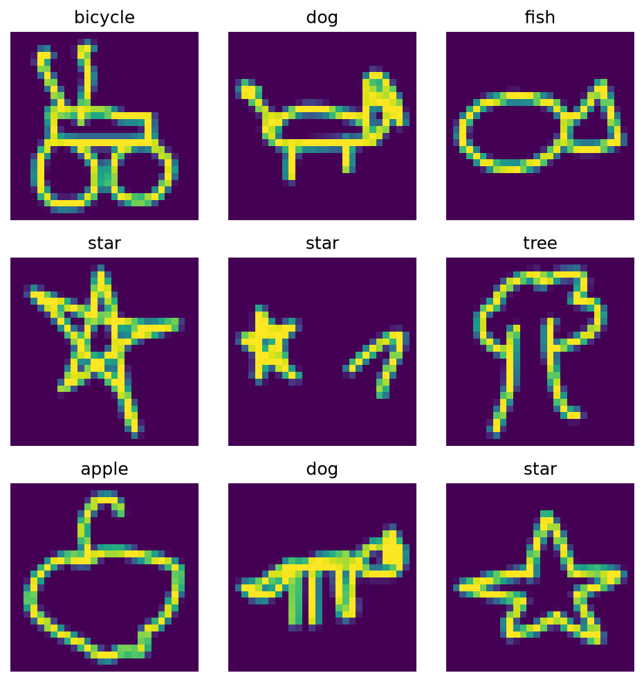
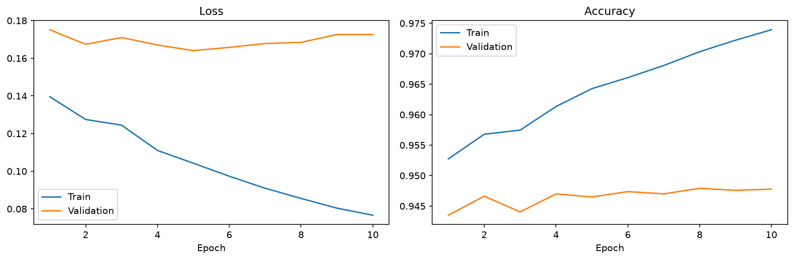

# quick-draw-clone

A doodle classifier inspired by Google's [Quick, Draw!](https://quickdraw.withgoogle.com/). Draw something, and a CNN guesses what it is.

Trained on 10 classes from the [Quick, Draw! dataset](https://github.com/googlecreativelab/quickdraw-dataset):

`cat` · `dog` · `house` · `car` · `tree` · `apple` · `fish` · `bicycle` · `star` · `airplane`



## Project structure

```
apps/
├── ml/    # data download, exploration, model training (PyTorch)
├── api/   # FastAPI inference service
└── web/   # Next.js drawing app (coming soon)
```

## Model

A small CNN on 28×28 grayscale bitmaps:

| Layer | Output |
| --- | --- |
| Conv 3×3 (32) → ReLU → MaxPool | 32 × 14 × 14 |
| Conv 3×3 (64) → ReLU → MaxPool | 64 × 7 × 7 |
| Conv 3×3 (128) → ReLU → MaxPool | 128 × 3 × 3 |
| Flatten → Linear (128) → ReLU → Dropout 0.3 | 128 |
| Linear | 10 |

**Training setup**

- 30,000 drawings per class (300,000 total)
- Split: 216,000 train / 24,000 validation / 60,000 test
- Pixels scaled to `[-1, 1]`
- AdamW (lr `3e-4`, weight decay `1e-2`), batch size 128, 10 epochs
- Best checkpoint chosen by validation loss

## Results

**Test accuracy: 94.4%** (test loss 0.174)



Validation accuracy levels off around 94.7% while training accuracy keeps rising, so the model starts to overfit after about 5 epochs.

## Running the ML part

```bash
cd apps/ml
pip install torch numpy matplotlib jupyter
```

Then run the notebooks in order:

1. `01_download_data.ipynb`: downloads the `.npy` files into `data/` (~1.1 GB)
2. `02_explore_data.ipynb`: shows one example per class
3. `03_train_model.ipynb`: trains the CNN and saves `best_model.pt`

Training uses Apple Silicon (`mps`) if available, otherwise CPU.

## Running the API

```bash
cd apps/api
pip install -r requirements.txt
uvicorn main:app --reload
```

Runs on `http://localhost:8000` and loads the model from `apps/ml/best_model.pt`. Interactive docs at `/docs`.

| Method | Path | Description |
| --- | --- | --- |
| `GET` | `/` | Health check |
| `POST` | `/predict` | Top 3 predictions for a drawing |

`/predict` takes 784 pixel values (a flattened 28×28 image, `0` = background, `255` = stroke):

```bash
curl -X POST http://localhost:8000/predict \
  -H "Content-Type: application/json" \
  -d '{"pixels": [0, 0, 0, ..., 0]}'
```

```json
{
  "predictions": [
    { "label": "cat", "probability": 0.9821 },
    { "label": "dog", "probability": 0.0113 },
    { "label": "fish", "probability": 0.0031 }
  ]
}
```

CORS allows `http://localhost:3000` for the web app. `apps/ml/get-single-image.ipynb` prints a real drawing as a pixel list for testing.

## Roadmap

- [ ] Next.js app with a drawing canvas
- [x] API to serve predictions
- [x] Train the classifier
